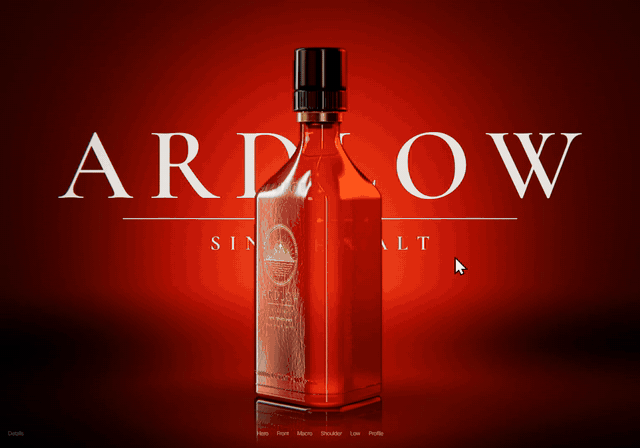

# Bottle Studio

A premium product studio for a whisky bottle, in one HTML file. Shape the glass, pour the whisky, light it, frame it with a real lens, and put your own hero type or artwork behind it to see how a web page would feel around the product. three.js, no build step, no 3D model files.

[](https://amirmushichge.github.io/bottle-studio/)

**Live:** https://amirmushichge.github.io/bottle-studio/ · [Full-quality video](assets/demo.mp4)

Made by [Amir Mushich](https://x.com/AmirMushich) · [amirmushich.com](https://amirmushich.com)

## What you can do
- **Shape the bottle.** Triangle, square or round section, corner radius, shoulder height and body width. The geometry is rebuilt live from code, and the fill level is reported in millilitres from the real inner volume.
- **Choose the glass and the spirit.** Five tinted glasses with a frost control, three whiskies or an empty bottle, four closures, three foil colours.
- **Light it.** Four studio rigs (Ember, Studio, Noir, Dusk) built from soft strip and round softboxes, with rig rotation, exposure and a glossy floor.
- **Shoot it.** Six camera shots (keys 1 to 6), focal length from 24 to 135 mm with dolly-zoom compensation, depth of field with round bokeh, and a turntable.
- **Try a hero layout.** Type a wordmark and a line, or upload a PNG, SVG, JPG or WebP (or drop it on the stage). The layer stays flat and sharp like a web hero, and the glass and whisky refract it.
- **Take a snapshot** of the current frame.

## Run it
Open `index.html` through any static file server. With [Node.js](https://nodejs.org/) and nothing to install:

```bash
node serve.mjs
```

Then open http://127.0.0.1:5340/. three.js and the fonts load from public CDNs, so the page needs a network connection.

## How it renders
- **Glass:** an arc-length parametrised sweep whose cross-section morphs from a rounded polygon to a circle through the shoulder. `MeshPhysicalMaterial` transmission with attenuation, dispersion and clearcoat; thickness grows at grazing angles so the walls read as solid glass. Embossed lettering and mould waviness come from a bump map drawn on a canvas.
- **Whisky:** three.js transmission cannot see another transmissive mesh, so the liquid is opaque and does its own refraction. Each frame the backdrop, hero layer and floor are rendered into a half-resolution buffer; the liquid samples it with a normal-driven offset and an amber filter, and the glass then refracts the result.
- **Light:** image-based only. Each rig is a small scene of soft-edged emissive cards baked through `PMREMGenerator`. There are no direct lights, because a point highlight refracted through the glass turned into a soft square.
- **Closure:** lathe geometry with a ribbed skirt, shadow groove and recessed top with a foil crest, an engraved foil collar, and a cork visible inside the neck.
- **Hero layer:** painted into the backdrop shader in screen space, so it lands in the refraction buffers. The lens blur skips its pixels and the sharp frame is keyed back by the layer's own alpha.
- **Post:** 4× MSAA half-float target, a custom lens pass (depth prepass, golden-angle gather blur for round bokeh), bloom, ACES tone mapping, and a light film pass with grain and vignette.

A full frame costs about 6 ms at 1440×900 on a laptop RTX 4070.

## Notes
Ardlow is a fictional brand. Its name, emblem and copy were made for this project and are not based on any real label.

## License
[MIT](LICENSE)
